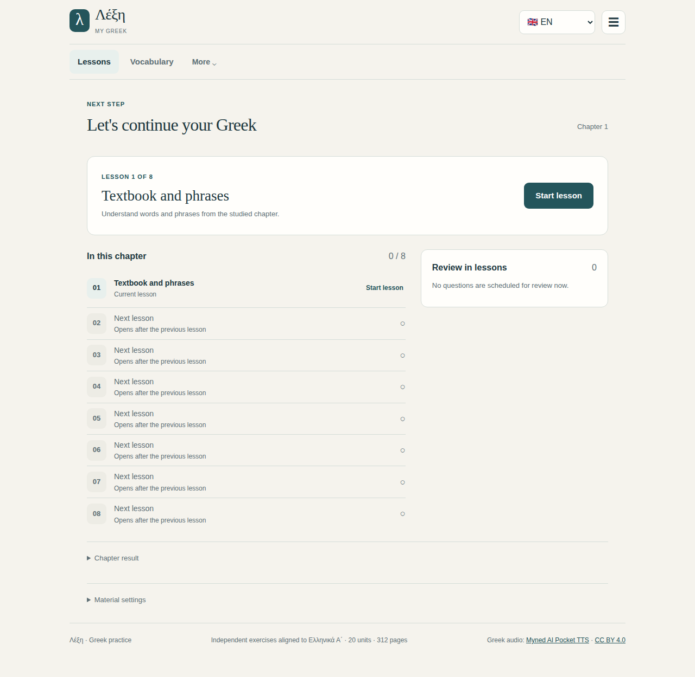
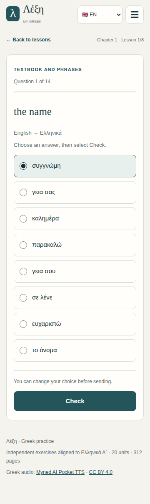
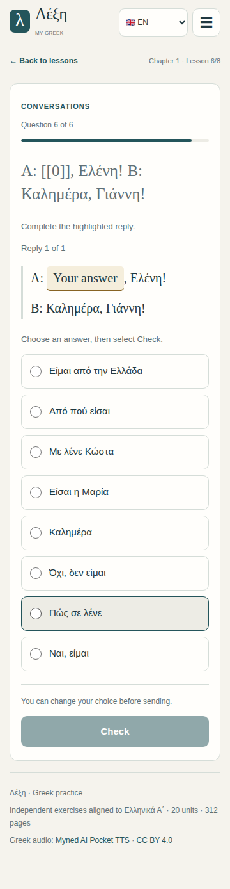
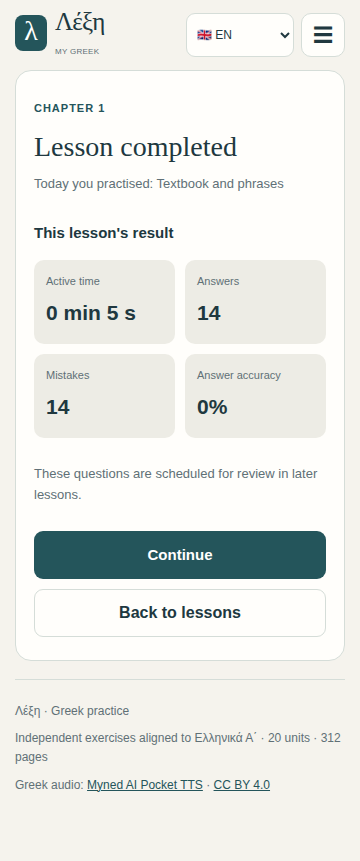
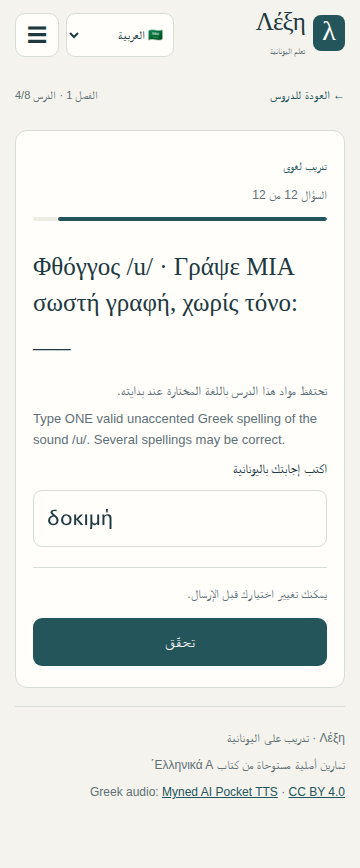
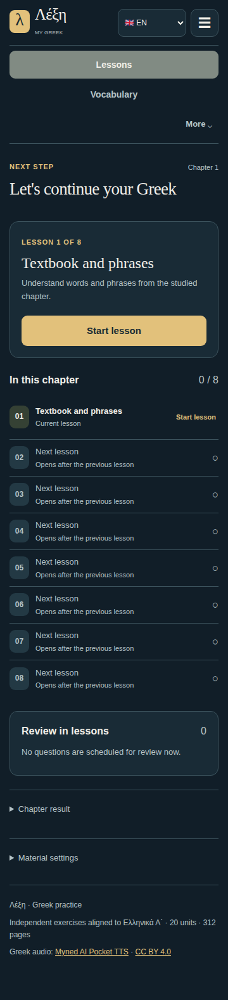

# Learning interface redesign — 2026-11-26

This implements the owner-authorized design/audit work in #66–88 using the
existing curriculum. The screenshots below show **synthetic test accounts**
and deliberately submitted test answers. Their scores are not learner data
or a claim about teaching effectiveness.

## Product decisions

The main screen answers one question: what should I do next? The current
lesson gets the primary action; the remaining chapter steps stay visible in
a quiet list. The broad introductory hero is removed from the repeated
learning journey. The existing vocabulary catalog remains directly available.
More contains Classic, card practice, Greek Life, Culture, mistakes, statistics
and the leaderboard.

Inside a lesson, content, the answer and feedback take priority. A choice is
an editable draft until Check. Typed Greek, ordered tokens, stress positions,
multi-gap dialogues and long agenda prompts have distinct controls while
sharing the same submit/feedback/continue boundary. The first submitted
answer remains final. A correct answer revealed in feedback cannot be
resubmitted to improve the grade.

Feedback stays visible until the learner continues. It preserves the existing
explanations, accepted variants, spelling/tonos guidance and eligible
translations. A pending or lost server response does not silently become a
second attempt. The UI resolves the stored receipt and resumes the authoritative
question, including when the learner leaves during saving.

The result screen reports the completed lesson's answers, errors, accuracy
and approximate active time, followed by a real next action. Completed results
can be reopened, including the latest result after a chapter transition.
Optional AI is attached to that result and defaults off.

## Navigation and state

| Destination | Existing surface |
|---|---|
| Lessons | Guided Board, eight lesson families per printed chapter |
| Vocabulary | Existing topical vocabulary catalog and lessons |
| More → Classic | Existing timed quiz, filters and session |
| More → card practice | Existing Anki/tracks |
| More → Greek Life | Existing situational scenes |
| More → Culture | Existing owner-approved Culture section |
| More → mistakes / statistics / leaderboard | Existing review and scoped progress |

Loading, signed-out, temporary server failure, empty material, paused lesson,
pending answer, uncertain save outcome, conflict, feedback and completion are
separate states. Authentication keeps focus within its active dialog and makes
the background inert. Profile failure offers retry without pretending that an
existing session disappeared.

The shell supports light and dark themes. Buttons have visible focus and
adequate touch areas; reduced motion is respected. Interface strings are
present for Russian, English, Chinese, Arabic, Spanish and Portuguese.
Greek blocks retain Greek language metadata and left-to-right direction inside
Arabic layouts. An already-started lesson keeps its source/translation language
and explicitly labels it when the interface language changes; the draft is
preserved.

## Scope and learning truth

The new composition uses existing early typed grammar, stress, syllable,
enclitic and order exercises. It preserves whole five-step scenarios and all
dialogue gaps, inserts eligible scheduled error review before filling a lesson,
and respects printed chapters and grammar milestones.

See [the generated 160-lesson matrix](LEARNING_PATH.md) for actual card IDs,
directions, response counts and shortages. In the representative audio-off,
no-backlog run, 14 of 160 lessons are shorter than their target. They remain
short instead of being filled with later material. No new course, parallel SRS
or replacement learning history is introduced.

Progress labels distinguish guided lessons, Classic/quiz, vocabulary and Life.
These counts are not additive measures of mastery. Current graded answers
appear in guided-lesson totals; chapter summaries describe completed lessons.
Unverified, skipped and assisted work are not silently treated as unaided
mastery.

## Screenshots

### Desktop home

### Mobile lesson and dialogue

### Result, Arabic/Greek direction and dark theme

The screenshots were captured before the final copy-only clarification
“approximate active time”; the final UI labels explicitly identify the estimate.

## Automated verification

The real Chromium browser gate uses an isolated SQLite database and synthetic
accounts. It completed six lesson families through the actual server formatters
and scorers and covered:

- auth focus, inert background and registration/success transitions;
- editable selection before Check and locked feedback afterward;
- a server-committed answer whose HTTP response is deliberately lost;
- leaving while an answer is pending, receipt recovery and paused/resumed state;
- typed Greek draft preservation across English/Arabic switches;
- all dialogue gaps and the visible active gap;
- Life answer recovery and honest deferral;
- immutable vocabulary retry and hidden Classic keyboard isolation on Board,
  Life, Vocabulary, Culture and Statistics, both before and after an answer;
- Classic autosave after a real commit and lost response, immutable retry bodies,
  newer draft preservation, unchanged deadlines and real second-device takeover;
- slow profile startup, unavailable API, profile 503 and an expired account cookie
  followed by login and restoration of the existing session;
- cross-tab account changes with held old profile/answer responses, immediate
  invalidation and rejection of stale-owner writes;
- real authored order/stress cards and agenda `g2261021_281`;
- 320/360/1280px layouts, both themes, six locales and RTL/LTR.

The AI interface has a separate fake-provider browser suite, including true
phrase-only reading retries, refresh without another upload and preservation
of the original full-reading result. Server tests cover owner isolation, atomic
reservations/receipts, immutable evidence, cancellation, deletion and late results. Actual WebM/Ogg/M4A decoding is checked with synthetic
tone audio. See [AI operations and pilot gates](AI.md).

CI runs the browser suite on pull requests and pushes and uploads synthetic
screenshots/logs for seven days. Container/source catalog fingerprints must
match, including all authored JSON and full-dialogue text assets.

## Remaining acceptance

Automated Chromium viewports are not physical iOS Safari or Android Chrome
microphone tests. An independent review of Greek and all six locales, a desktop
screen-reader pass, a small learner observation session and the real AI
quality/cost pilot remain explicit acceptance work. The implementation does not
claim those checks have occurred. The open issues retain those criteria rather
than treating filled locale arrays or mock transcripts as proof.

Release continues through the existing protected-branch/green-CI GitOps
process. No deployment guard is removed by this redesign.
